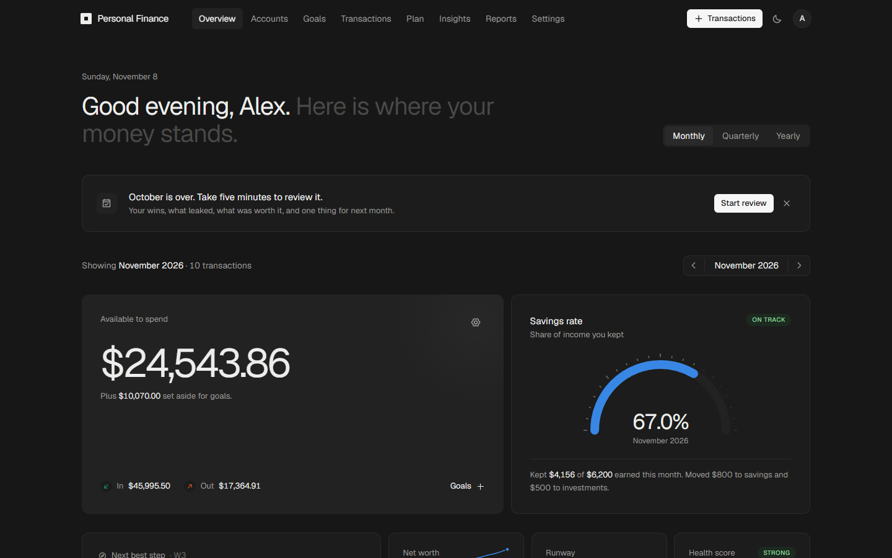

# Personal Finance App

A modern, full-stack personal finance application for tracking income and expenses, organizing spending by category, setting monthly budgets, and exporting financial reports. The application is multi-tenant, providing secure, isolated data for each user.

**Live demo:** [bank-ar.vercel.app](https://bank-ar.vercel.app) · Built by [Ashikur Rahman](https://ashikurrahman.vercel.app), planned and written with Claude Code as my AI pair programmer.



## Key decisions

- **Money is stored as integer minor units** (`bigint` cents), never floating point, and formatted per ISO 4217 currency with optional lakh/crore grouping.
- **The refresh token is a first-party, httpOnly cookie.** The browser calls `/api/v1` on the Next.js origin and Next.js rewrites to the API, so middleware can read the cookie and protect routes.
- **Two-factor secrets are encrypted at rest**, with their own key separate from the JWT secrets.
- **A nonce-based Content-Security-Policy** is set on every page request.
- **All money math lives in pure `calc/` modules**, away from controllers and the database, so it can be unit-tested on its own.
- **Rate limits use Redis when it's available**, so limits hold across several API instances. Without Redis they fall back to memory.

## Tests

```bash
cd backend
npm test
```

13 unit-test files cover currency formatting, account balances, budget plan math, goal funding, recurrence schedules, the health score, net worth, the next-best-action engine, spending insights, the monthly review, and income and investment calculations.

---

## Features

### Implemented

**Authentication & security**
- User registration and login with JWT access tokens and httpOnly refresh-token cookies
- Google OAuth sign-in
- Two-factor authentication (TOTP) with encrypted secrets
- Password change, profile management, and route protection via Next.js middleware
- Nonce-based Content-Security-Policy enforced on every page request

**Financial data**
- **Transactions** — Create, read, update, and delete income, expense, and transfer entries with dates, notes, categories and accounts. Transfers move money between your own accounts (into savings, investments or onto a card) and never count as income or spending
- **Recurring** — Salary, bills, subscriptions and regular transfers ("invest every payday", debt payments) on weekly to yearly schedules with month-end clamping. Automatic rules are recorded when due — a recorded salary shares itself out to income-funded goals — and the rest wait under "Due" to be confirmed (with the actual amount) or skipped. Billing-month offset for rent paid in arrears; "Make recurring" from any entry; subscription totals per month and year; a "Coming up" panel on the dashboard. Rules can be paused and resumed
- **Categories** — Custom income and expense categories with colors and icons (managed in Settings). Expense categories are marked need/want and fixed/variable and can count toward ratios such as housing or debt interest; income categories are marked active, passive or portfolio
- **Spending plan** — A monthly plan ordered the way money should flow: pay yourself first (goal funding and other saving), then needs, then wants. Expected income suggested from the last 3 months; 50/30/20, 70/20/10, zero-based or caps-only methods with targets; per-category budgets with rollover, 3-month averages and median suggestions; copy last month; move budget between categories when one runs over
- **Accounts** — Bank, cash, mobile wallet, savings, investment, retirement and property assets plus credit cards and loans, with balances, a six-month trend, net worth, and money available to spend. Investment, retirement and property accounts take dated valuations (value = latest valuation plus money moved since), with a reminder when a value is over a month old. Archive (zero balance) or delete (unused) accounts
- **Insights** — A financial health score (0–100) from nine measures — savings and investing rate, emergency cover, debt payments, high-interest debt, housing and fixed costs, net-worth trend, insurance — each shown with its value, target and how to improve; one Next Best Action that walks the money waterfall (starter buffer → employer match → high-interest debt → emergency fund → investing 15% → sinking funds → insurance) with a concrete monthly amount; runway in months (full lifestyle and essentials only); month-end net worth history; and up to three spending insights (category running high, unusually large expense, untracked subscription, lifestyle creep). Shown on the dashboard and on the dedicated Insights page
- **Wealth building** — Debt payoff planner comparing avalanche, snowball and minimums (payoff dates, interest saved, warnings when a minimum does not cover interest) that can schedule monthly payments; a financial-independence calculator (FI number, years to FI, coast FI, passive-income coverage and a savings-rate × return table); investment tracking (12-month return from your valuations, asset mix against a target with rebalancing advice, yearly fees and 20-year fee drag, months invested); and income tracking (by kind, sources, concentration, year-over-year growth). All on the Insights page under the Debt / Independence / Investments / Income tabs
- **Habits** — A monthly review (once a month): the numbers (savings rate vs target, net-worth and health-score change), three wins, three leaks, a "worth it?" rating of the biggest discretionary categories (repeated "not worth it" suggests a lower budget), and one commitment that the next review checks. A cooling-off list for wants: non-essential expenses above your threshold can wait 24 hours to 30 days, then you buy (pre-filled expense) or skip, with skipped totals for the year and one tap to set skipped money aside for a goal
- **Goals** — Money set aside inside your accounts: an emergency fund sized from essential spending (with a one-month starter milestone), sinking funds with dates (optionally yearly and linked to a spending category), and other goals. Fund goals with a percent of every income or a fixed monthly amount so income is shared out the moment eligible income is recorded (with Undo), or add money by hand; withdrawals ask for a reason. Automatic funding follows goal priority, is limited by the available income, and respects regular goal targets. Emergency-fund targets are estimates and do not cap contributions. Available to spend = liquid money minus goal money. Goals are reorderable; archive or delete when done
- **Calculations** — Monthly, quarterly, and yearly summaries, category breakdowns, range summaries, and a unified dashboard overview endpoint (monthly + yearly + breakdown + account summary + insights in one request)
- **Reports** — CSV and PDF export for any date range in the user's currency, with preview and local download history
- **Currency & number format** — Any ISO 4217 currency and a choice of number grouping (including lakh/crore); money is stored as 64-bit minor units
- **Financial profile** — Income stability (with a suggestion from recent income), dependents, insurance and employer match, plus retirement assumptions and cooling-off threshold, used to tailor targets and advice

**Frontend**
- **Dashboard** — Monthly, quarterly, and yearly views with Recharts visualizations; recurring entries materialize automatically when the dashboard opens
- **Accounts** — Full account management page: create, edit, archive/restore, delete; six-month sparkline trend; net worth and available-to-spend totals; valuation entry for investment/retirement/property accounts
- **Goals** — Full goals page with emergency fund card, goal cards with animated progress bars, add/withdraw money modals, reorder via arrows, archive/restore/delete, and inline cooling-off list
- **Insights** — Dedicated page with Health / Debt / Independence / Investments / Income tabs, net worth area chart with 1/2/5-year range selector, health score card, next best action card, and spending insights
- **Monthly Review** — Wizard-style review page with animated step transitions: numbers → wins → leaks → worth it? → one thing
- **Transactions** — Paginated ledger with filters and modal create/edit forms; recurring entries appear immediately on open
- **Budgets** — Full spending plan UI: expected income, method picker, per-category budgets, move-money form, copy-last-month, and bulk suggestions
- **Reports** — Date-range picker, format selection, and one-click downloads
- **Settings** — Profile, security (2FA), preferences (appearance, currency, timezone), financial profile, categories, and account configuration
- **Form controls** — Searchable custom selects and calendar-based date inputs are used across forms for consistent styling and keyboard-accessible selection. Account opening balances and low-balance thresholds accept decimal amounts
- **Guide** — Onboarding walkthrough for new users
- **Landing page** — Marketing home page with links to auth flows

**Platform**
- PostgreSQL schema and Drizzle migrations
- Standardized API responses, validation, logging, request IDs, and global error handling
- Swagger/OpenAPI docs at `/api/docs` (enabled in development; set `ENABLE_SWAGGER=true` in production to expose)
- Rate limiting via `@nestjs/throttler` with optional Redis-backed storage
- User-level in-memory cache (`UserCacheModule`) for hot account lookups
- Local infrastructure via Docker Compose (PostgreSQL and Redis)

### Planned / in progress

- Additional polish, tests, and production hardening
- See [`IMPLEMENTATION_PLAN.md`](./IMPLEMENTATION_PLAN.md) for the historical roadmap

---

## Tech Stack

**Frontend** ([`frontend/`](./frontend))
- Framework: **Next.js 15** (React 19, App Router)
- Styling: **Tailwind CSS v4** (Carbon-inspired design system)
- State & data fetching: **TanStack React Query v5**
- Forms & validation: **React Hook Form** + **Zod**
- UI & charts: **Phosphor Icons** + **Recharts**
- Animation: **Framer Motion**

**Backend** ([`backend/`](./backend))
- Framework: **NestJS 11** (Node.js 20+)
- Language: **TypeScript**
- Database: **PostgreSQL 16**
- ORM: **Drizzle ORM**
- Validation: `class-validator` & `class-transformer`
- Security: Helmet, CORS, bcrypt, JWT, cookie-based refresh tokens
- Docs: **Swagger** via `@nestjs/swagger`
- Reports: **@react-pdf/renderer**, **fast-csv**

**Infrastructure**
- **Docker**: Docker Compose runs the complete stack (Next.js, NestJS, PostgreSQL, and Redis)
- **Production**: Frontend on **Vercel**, backend on **Render**, database on **Neon** (PostgreSQL)

---

## Repository Structure

```text
personal-finance/
├── backend/                # NestJS REST API, Drizzle schema, and migrations
├── frontend/               # Next.js client app (App Router)
├── docker-compose.yml      # Local PostgreSQL and Redis
├── ARCHITECTURE.md         # System architecture and design patterns
├── DESIGN.md               # UI/design system notes
├── WIKI.md                 # Extended project documentation
└── README.md               # This file
```

---

## Run without Docker (development)

## Run the complete app with Docker

Install Docker Desktop, then from the repository root copy the Docker environment
template and start the stack:

```bash
cp .env.example .env
docker compose up --build
```

On PowerShell, use `Copy-Item .env.example .env` for the first command. Change the
placeholder secrets in `.env` before using the app outside local development. The
Docker setup runs database migrations automatically, and persists database and Redis
data in named Docker volumes.

- App: `http://localhost:3000`
- API: `http://localhost:3001/api/v1`
- API docs: `http://localhost:3001/api/docs`

To stop the stack, run `docker compose down`. Add `-v` only when you deliberately
want to remove the persisted local database and Redis data.

### 1. Start infrastructure

From the repository root, start PostgreSQL and Redis:

```bash
docker compose up -d postgres redis
```

### 2. Run the backend API

```bash
cd backend
cp .env.example .env
npm install
npm run db:migrate
npm run start:dev
```

The API listens at `http://localhost:3001/api/v1`. Interactive API docs are at `http://localhost:3001/api/docs`.

Set `FRONTEND_URL` in `backend/.env` to match your frontend origin (default Next.js dev server: `http://localhost:3000`).

### 3. Run the frontend

```bash
cd frontend
cp .env.example .env
npm install
npm run dev
```

The UI is available at `http://localhost:3000`.

Browser requests go to `/api/v1` on the frontend origin. Next.js rewrites those calls to the backend (`API_PROXY_TARGET`, default `http://localhost:3001/api/v1`), keeping the `refresh_token` cookie first-party so middleware can read it.

---

## Deployment

Production is split across three managed services:

| Component | Platform | Description |
|-----------|----------|-------------|
| **Frontend** | [Vercel](https://vercel.com) | Next.js app — deploy from the `frontend/` directory |
| **Backend** | [Render](https://render.com) | NestJS API — web service with secrets and DB connection env vars |
| **Database** | [Neon](https://neon.tech) | Serverless PostgreSQL — connection string provided to Render |

**Backend (Render)**
- Set `DATABASE_URL` to your Neon connection string
- Configure `JWT_SECRET`, `REFRESH_TOKEN_SECRET`, `TWO_FACTOR_ENCRYPTION_KEY`, `FRONTEND_URL` (your Vercel domain), and `BACKEND_URL` (your Render service URL)
- Optionally set `REDIS_URL` for distributed rate limiting and `GOOGLE_CLIENT_ID` / `GOOGLE_CLIENT_SECRET` for OAuth

**Frontend (Vercel)**
- Route browser API calls through the frontend origin so the `refresh_token` is a first-party cookie that Next.js middleware can read
- Set `NEXT_PUBLIC_API_URL=/api/v1`
- Set the server-only `API_PROXY_TARGET=https://<your-render-service>.onrender.com/api/v1`
- Do **not** point `NEXT_PUBLIC_API_URL` directly at Render

**Local vs production**
- Local development uses Docker Compose for Postgres and Redis; production uses Neon instead of a self-hosted database
- Redis is optional locally but recommended in production for consistent rate limiting across instances

---

## Documentation

| Document | Contents |
|----------|----------|
| [WIKI.md](./WIKI.md) | Data model, API conventions, and project overview |
| [ARCHITECTURE.md](./ARCHITECTURE.md) | Client/server architecture, modules, and security flow |
| [DESIGN.md](./DESIGN.md) | Carbon-inspired UI design system |
| [backend/README.md](./backend/README.md) | Backend setup, env vars, database scripts, and API details |

For live endpoint reference during development, open `http://localhost:3001/api/docs` after starting the backend.
