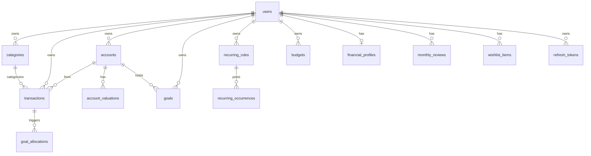

# Personal Finance App — Project Wiki

A modern, full-stack personal finance web application for tracking income and expenses, organizing spending by category, setting monthly budgets, building savings goals, and exporting financial reports. Built with a multi-tenant architecture where every user's financial data is strictly isolated and secure.

The application features a NestJS 11 REST API, a Next.js 15 (React 19) App Router frontend, a PostgreSQL 16 database managed with Drizzle ORM, and optional Redis 7 caching and rate limiting.

---

## Table of Contents

- [What Problem Does It Solve?](#what-problem-does-it-solve)
- [Architecture](#architecture)
- [Tech Stack](#tech-stack)
- [Data Model](#data-model)
- [Feature Status & Roadmap](#feature-status--roadmap)
- [Repository Layout](#repository-layout)
- [Quick Start](#quick-start)
  - [Option A: Full Stack with Docker (Recommended)](#option-a-full-stack-with-docker-recommended)
  - [Option B: Local Development (Hybrid Docker)](#option-b-local-development-hybrid-docker)
- [Frontend Routes](#frontend-routes)
- [API Snapshot](#api-snapshot)
- [Conventions & Security](#conventions--security)
- [License](#license)

---

## What Problem Does It Solve?

Managing personal finances often involves cumbersome spreadsheets or overly complex tools that do not match daily spending workflows. This app provides a clean, focused, and intuitive financial dashboard:

- **Track Transactions** — Record income, expense, and transfer entries with dates, amounts, categories, accounts, and descriptive notes.
- **Multi-Account Management** — Track any number of accounts (bank, savings, investment, retirement, property, credit cards, loans), with balances, six-month trends, net worth, and money available to spend.
- **Recurring Entries** — Define salary, bills, subscriptions, and regular transfers on weekly-to-yearly schedules; auto-post or confirm with the actual amount; see what's coming up.
- **Spending Plan & Budgets** — Monthly plan ordered by the money waterfall: pay yourself first (goals), then needs, then wants. Multiple budgeting methods; copy from last month; move money between categories.
- **Goals** — Earmark money inside your accounts (emergency fund, sinking funds, long-term targets). Automatic funding from income; income priority ordering; archive and restore.
- **Insights & Health Score** — A 0–100 financial health score from nine measures, one Next Best Action, runway in months, and up to three spending insights. Wealth tools: debt payoff planner, FI calculator, investment and income tracking.
- **Monthly Review** — A wizard-style review once a month: numbers, wins, leaks, worth-it ratings, and a commitment carried into the next review. A cooling-off list delays impulsive purchases.
- **Visual Analytics** — Interactive dashboards with monthly, quarterly, and yearly summaries plus visual category breakdowns powered by Recharts.
- **Export Financial Reports** — Generate and download CSV and PDF reports for custom billing periods with preview and history tracking.
- **Theme Customization** — Native dark and light mode support with automatic system preference detection and local storage persistence.
- **Enterprise-Grade Security** — Email/password credentials, Google OAuth 2.0, short-lived JWT access tokens with rotating httpOnly refresh cookies, optional TOTP-based 2FA, and nonce-based Content-Security-Policy.

> [!NOTE]
> **Currency Handling**: Monetary values are stored as **integer cents** in PostgreSQL (`amountCents`) to eliminate floating-point rounding errors. User-facing inputs and standard API request/response payloads utilize **decimal dollars** (e.g. `49.99`).

---

## Architecture

The system uses a decoupled client-server model. The Next.js frontend owns the browser origin and proxies API requests to the backend, keeping authentication cookies first-party.

```
┌────────────────────────────────┐       /api/v1 (same origin)       ┌───────────────────────────────┐
│     Next.js 15 Client          │ ◄───────────────────────────────► │       NestJS 11 API           │
│  (Port 3000 / Vercel / Docker) │     rewrite → API backend         │ (Port 3001 / Render / Docker) │
└───────────────┬────────────────┘                                   └───────┬──────────────┬────────┘
                │ middleware: route guard + nonce CSP                        │              │
                │ (first-party httpOnly cookie via proxy)                    │ SQL          │ Throttler
                │                                                            ▼              ▼
                │                                                     ┌────────────┐ ┌────────────┐
                │                                                     │ PostgreSQL │ │   Redis    │
                │                                                     │     16     │ │  7 (opt.) │
                └─────────────────────────────────────────────────────└────────────┘ └────────────┘
```

| Component | Location | Role |
| --- | --- | --- |
| **Frontend** | [`frontend/`](frontend/) | Next.js 15 App Router UI — dashboard, accounts, goals, insights, review, transactions, budgets, reports, settings |
| **Backend API** | [`backend/`](backend/) | NestJS REST API under `/api/v1` — authentication, CRUD, aggregation, insights, reports |
| **Database** | [`backend/src/db/`](backend/src/db/) | PostgreSQL 16 relational database with Drizzle ORM schemas and migrations |
| **Infrastructure** | [`docker-compose.yml`](docker-compose.yml) | Docker Compose orchestrating PostgreSQL 16, Redis 7, NestJS API, and Next.js |
| **Production** | Vercel + Render + Neon | Frontend deployed on Vercel, API hosted on Render, PostgreSQL hosted on Neon |

### API Proxy & Cookie Strategy

In development and production, the browser communicates strictly with the frontend origin (`/api/v1/*`). Next.js rewrites these requests to the backend API (`API_PROXY_TARGET`):
- Keeps the `refresh_token` httpOnly cookie first-party, avoiding cross-site third-party cookie restrictions.
- Allows Next.js Edge middleware to detect session presence and gate protected routes before rendering.
- Eliminates CORS issues in production environments.

---

## Tech Stack

| Layer | Technology | Description |
| --- | --- | --- |
| **Frontend Framework** | Next.js 15 (React 19) | App Router, Server and Client Components, Edge Middleware |
| **Styling & Design** | Tailwind CSS v4 | Carbon-inspired UI design tokens, responsive typography, dark mode support |
| **Client State & Cache** | TanStack React Query v5 | Server state caching, optimistic updates, background refetching |
| **Forms & Validation** | React Hook Form + Zod | Type-safe form validation and error handling |
| **Visualizations** | Recharts & Phosphor Icons | Area, bar, donut and sparkline charts, plus UI iconography |
| **Animation** | Framer Motion | Page reveals, animated progress bars, review wizard transitions |
| **Backend Framework** | NestJS 11 (Node.js 20+) | Modular TypeScript architecture with dependency injection |
| **Database & ORM** | PostgreSQL 16 + Drizzle ORM | Type-safe queries, relational joins, and automated schema migrations |
| **API Validation & Docs** | class-validator & Swagger | DTO validation, transformation, and OpenAPI 3.0 documentation at `/api/docs` |
| **Authentication & Crypto** | Passport, JWT, bcrypt, speakeasy | Access/refresh token lifecycle, encrypted TOTP secrets, OAuth 2.0 |
| **Reports Engine** | fast-csv & @react-pdf/renderer | Streaming CSV generation and server-side PDF document rendering |
| **Rate Limiting** | @nestjs/throttler | IP/user rate limiting backed by in-memory or Redis storage |
| **Containerization** | Docker & Docker Compose | Multi-stage production container builds and automated migration entrypoints |

---

## Data Model

All models are defined in [`backend/src/db/schema/index.ts`](backend/src/db/schema/index.ts) with strict multi-tenant isolation:



| Table | Purpose |
| --- | --- |
| **`users`** | Account identity: email, password hash, optional Google ID, avatar URL, encrypted 2FA secret, timezone, soft delete. |
| **`categories`** | Income and expense categories scoped per user: name, type, color, icon, sort order, kind metadata (need/want, fixed/variable, income kind), default status. |
| **`transactions`** | Ledger entries: amount in cents, type (`income`/`expense`/`transfer`), date, note, accountId, counterAccountId, denormalized month/year. |
| **`accounts`** | Multi-account registry: kind, name, color, icon, opening balance, low-balance threshold, default flag, archivedAt. |
| **`account_valuations`** | Dated market values for investment, retirement, and property accounts. |
| **`goals`** | Named money earmarks inside accounts: kind, funding rule, target amount/date, archivedAt. |
| **`goal_allocations`** | Links an income transaction to the goal contributions it triggered (for Undo). |
| **`recurring_rules`** | Schedule definitions: frequency, amount, account, category or counterAccount, auto-post flag, billing offset. |
| **`recurring_occurrences`** | Posted or skipped instances of a recurring rule. |
| **`financial_profiles`** | One row per user: income stability, dependents, insurance, employer match, retirement assumptions, cooling-off hours. |
| **`monthly_reviews`** | Completed monthly review answers: wins, leaks, worth-it ratings, commitment text. |
| **`wishlist_items`** | Cooling-off list entries: name, amount, status, decided-at timestamp. |
| **`budgets`** | Monthly budget rows: global or per-category cap, budgeting method, expected income, notes. |
| **`account_config`** | One row per user (legacy): opening balance and low-balance alert threshold. |
| **`savings_sectors`** | Named allocation buckets (legacy): percentage, styling, optional target. |
| **`refresh_tokens`** | Secure session storage: hashed token value, family rotation UUID, expiration, user-agent, IP fingerprint. |

---

## Feature Status & Roadmap

### Implemented

#### Authentication & Security
- User registration and password login with validation.
- Short-lived JWT access tokens (15m in memory) and long-lived httpOnly `refresh_token` cookies (7d) with automatic token rotation and family invalidation.
- Google OAuth 2.0 authentication (`GET /auth/google`, `GET /auth/google/callback`).
- Time-based One-Time Password (TOTP) 2FA: setup, activation, disable.
- Profile management (display name, avatar, timezone) and secure password change.
- Nonce-based Content-Security-Policy on every page request via Edge Middleware.
- Centralized frontend client with automatic 401 token refresh queue and session recovery.

#### Multi-Account System
- Any number of accounts: bank, cash, mobile wallet, savings, investment, retirement, property, credit card, loan.
- Per-account balances, six-month trend sparkline, net worth totals, and money available to spend.
- Investment/retirement/property accounts accept dated valuations; balance = latest valuation + net money moved since.
- Archive (balance must be zero) or delete (no transactions) accounts; restore archived accounts.

#### Transactions
- Searchable, paginated transaction ledger with filters (type, category, account, date range).
- Three transaction types: income, expense, and **transfer** (moves money between accounts; not counted as income or spending).
- Create/edit modals with projected balance preview. Soft-delete persistence.

#### Recurring Rules
- Weekly, biweekly, monthly, quarterly, and yearly schedules with month-end date clamping and billing-month offset.
- Auto-post mode (salary, rent, regular investing) vs. confirm mode (wait in "Due" until confirmed with actual amount or skipped).
- Pause and resume rules; occurrences missed while paused are not backdated.
- Subscription totals per month and year; "Coming up" panel (next 30 days).
- Recorded salary income triggers goal auto-allocation with Undo.

#### Spending Plan & Budgets
- Monthly spending plan: pay-yourself-first (goals/saving), needs, wants — ordered by the money waterfall.
- Expected income suggested from last 3 months; four budgeting methods (50/30/20, 70/20/10, zero-based, caps-only).
- Per-category budgets with rollover, 3-month average, and median suggestions.
- Bulk upsert, copy-from-last-month, and move-money-between-categories.

#### Goals
- Emergency fund auto-sized from essential spending (6× monthly average), with a 1-month starter milestone.
- Sinking funds (with target date, optional yearly repeat, optional linked spending category).
- Long-term and custom goals.
- Fund with % of each income, fixed monthly amount, or manual top-ups.
- Eligible income in a liquid asset account automatically shares itself out to funded goals in priority order (reorderable); the allocation never exceeds that income. Percent rules calculate from each income; fixed monthly rules fill the remaining monthly amount. Regular goal targets cap automatic contributions, while the emergency fund's estimated target does not cap them. Undo available.
- Contributions (add) and withdrawals (with required reason).
- Archive / restore / delete goals; emergency fund cannot be deleted.

#### Insights & Health Score
- Financial health score (0–100) from nine weighted measures: savings rate, investing rate, emergency cover, debt payments, high-interest debt, housing costs, fixed costs, net-worth trend, insurance.
- One Next Best Action walking the money waterfall with a concrete monthly dollar amount.
- Runway in months at full lifestyle and essentials-only.
- Month-end net worth history (up to 60 months) with area chart.
- Up to three spending insights: category running high, unusually large expense, untracked subscription, lifestyle creep.
- Valuation prompts when an investment/retirement/property account is stale (>1 month).

#### Wealth Tools (on Insights page)
- **Debt** — Payoff planner comparing avalanche, snowball, and minimums; shows payoff dates, interest saved, and warns when a minimum doesn't cover interest. Can schedule recurring monthly payments.
- **Independence** — FI number, years to FI, coast FI date, passive-income coverage, savings-rate × return table.
- **Investments** — 12-month return (Modified Dietz from valuations), asset mix vs. target with rebalancing advice, yearly fees and 20-year fee drag, months invested.
- **Income** — Income by kind (active/passive/portfolio), by source, concentration index, year-over-year growth.

#### Monthly Review & Habits
- Monthly review wizard: numbers (income, spending, savings rate vs target, net-worth change, health-score change) → wins → leaks → worth-it ratings → one commitment.
- Commitment from previous review shown in the next review for accountability.
- Repeated "not worth it" ratings surface as budget reduction suggestions.
- Cooling-off list: add a want, wait 24 h–30 days, then buy (pre-filled expense) or skip. Skipped totals for the year; one tap to redirect skipped money to a goal.

#### Analytics & Calculations
- Monthly, quarterly, yearly, and date-range summaries.
- Category breakdown by month.
- Unified dashboard overview endpoint (monthly + yearly + breakdown + account summary + today's insights in one request); recurring entries materialize first.

#### Reports
- Customizable date range, preview data, streaming CSV export, PDF generation.

#### Frontend & UI
- Responsive layout with desktop sidebar and mobile navigation.
- Dark mode and light mode switcher with system preference fallback and saved preference restored across page refreshes.
- Shared custom select and date-picker controls replace native form menus where used. Selects support keyboard navigation and optional search for longer lists; date inputs use a calendar popover.
- Account opening balances and low-balance thresholds accept decimal amounts.
- Carbon-inspired design tokens; compact typography; animated skeleton loaders.
- Tabbed settings page (Profile, Security & 2FA, Preferences, Financial Profile, Categories, Account configuration).
- Onboarding guide for new users (`/guide`).
- Standalone error boundary and not-found page.

#### Infrastructure & Operations
- Complete Dockerization with multi-stage Dockerfiles for backend and frontend.
- Automated database migrations run on container startup via `backend/docker-entrypoint.sh`.
- Comprehensive Swagger/OpenAPI interactive documentation at `/api/docs`.
- Standardized API response envelopes (`{ data, meta }`) and global error formatting.
- Health check endpoint at `/health`.

---

## Repository Layout

```text
PF/
├── backend/                        # NestJS REST API
│   ├── Dockerfile                  # Production multi-stage Docker build
│   ├── docker-entrypoint.sh        # Container startup migration runner
│   ├── drizzle/                    # Generated SQL migration files
│   ├── drizzle.config.ts           # Drizzle Kit configuration
│   ├── src/
│   │   ├── common/                 # Guards, interceptors, filters, decorators, cache
│   │   ├── config/                 # Joi-validated environment config
│   │   ├── db/                     # Drizzle schema definitions and database connection
│   │   ├── modules/
│   │   │   ├── account/            # Legacy account-config and savings sectors
│   │   │   ├── accounts/           # Multi-account CRUD, balances, valuations
│   │   │   ├── auth/               # JWT, cookies, Google OAuth, TOTP 2FA
│   │   │   ├── budgets/            # Monthly spending plan and budget limits
│   │   │   ├── calculations/       # Monthly, quarterly, yearly, range, dashboard overview
│   │   │   ├── categories/         # Category CRUD and default seeders
│   │   │   ├── financial-profile/  # User financial profile (income, dependents, insurance)
│   │   │   ├── goals/              # Goal CRUD, contributions, withdrawals, income allocation
│   │   │   ├── health/             # Liveness endpoint
│   │   │   ├── insights/           # Health score, next action, runway, net worth, spending insights
│   │   │   ├── ledger/             # Shared ledger validation rules
│   │   │   ├── recurring/          # Recurring rules, materialization, confirm/skip/pause
│   │   │   ├── reports/            # CSV (fast-csv) and PDF (@react-pdf/renderer)
│   │   │   ├── reviews/            # Monthly review status and completion
│   │   │   ├── transactions/       # Ledger CRUD (income/expense/transfer), filters, projected balance
│   │   │   ├── users/              # User profile and password management
│   │   │   ├── wealth/             # Debt, FI, investments, income tracking
│   │   │   └── wishlist/           # Cooling-off list
│   │   └── main.ts                 # Bootstrap, Swagger setup, global pipes
│   └── package.json
├── frontend/                       # Next.js 15 App Router client
│   ├── Dockerfile                  # Standalone Next.js Docker build
│   ├── next.config.ts              # API proxy rewrites (/api/v1 -> backend)
│   ├── src/
│   │   ├── app/
│   │   │   ├── (app)/              # Authenticated layout & routes
│   │   │   │   ├── account/        # Legacy account-config page
│   │   │   │   ├── accounts/       # Multi-account management page
│   │   │   │   ├── budgets/        # Spending plan and budget management page
│   │   │   │   ├── dashboard/      # Analytics dashboard (monthly/quarterly/yearly)
│   │   │   │   ├── goals/          # Goals and cooling-off list page
│   │   │   │   ├── guide/          # Onboarding guide page
│   │   │   │   ├── insights/       # Health, debt, FI, investments, income page
│   │   │   │   ├── reports/        # Financial reports export page
│   │   │   │   ├── review/         # Monthly review wizard page
│   │   │   │   ├── settings/       # Settings tabs (profile, security, categories, etc.)
│   │   │   │   └── transactions/   # Transaction ledger and CRUD modals
│   │   │   ├── (auth)/             # Auth layout (login, register)
│   │   │   ├── globals.css         # Tailwind CSS v4 design tokens & dark mode
│   │   │   ├── layout.tsx          # Root HTML layout and providers
│   │   │   └── page.tsx            # Public marketing landing page
│   │   ├── components/             # Reusable UI, form, layout, and chart components
│   │   └── lib/                    # API clients, React Query hooks, format utilities
│   └── package.json
├── docker-compose.yml              # Local & full-stack container orchestration
├── .env.example                    # Root environment variable template for Docker
├── ARCHITECTURE.md                 # System architecture and design documentation
├── DESIGN.md                       # Carbon-inspired design system specifications
├── E2E_QA_TICKET.md                # End-to-end testing matrix and defect tracking
├── README.md                       # Quick start and project overview
└── WIKI.md                         # Extended project wiki (this document)
```

---

## Quick Start

You can run the application using either **Docker Compose** (full stack containerized) or in **Local Development mode** (running Postgres/Redis in Docker and Node services on the host).

### Option A: Full Stack with Docker (Recommended)

Requires [Docker Desktop](https://www.docker.com/products/docker-desktop/).

1. **Copy the root environment configuration**:
   - On Bash / macOS / Linux:
     ```bash
     cp .env.example .env
     ```
   - On Windows PowerShell:
     ```powershell
     Copy-Item .env.example .env
     ```

2. **Configure secrets in `.env`**:
   Ensure `JWT_SECRET`, `REFRESH_TOKEN_SECRET`, and `TWO_FACTOR_ENCRYPTION_KEY` (64-character hex string) are set.

3. **Start the complete stack**:
   ```bash
   docker compose up --build
   ```

   - **Frontend App**: `http://localhost:3000`
   - **Backend API**: `http://localhost:3001/api/v1`
   - **Interactive API Docs (Swagger)**: `http://localhost:3001/api/docs`

To stop the containers:
```bash
docker compose down
```
*(Add `-v` if you wish to reset the database and Redis volumes).*

---

### Option B: Local Development (Hybrid Docker)

#### 1. Start Database & Redis
From the repository root:
```bash
docker compose up -d postgres redis
```

#### 2. Run the Backend API
```bash
cd backend
cp .env.example .env     # or Copy-Item .env.example .env
npm install
npm run db:migrate       # Apply Drizzle migrations
npm run start:dev        # Starts NestJS watch mode on port 3001
```

#### 3. Run the Frontend Client
In a separate terminal:
```bash
cd frontend
cp .env.example .env     # or Copy-Item .env.example .env
npm install
npm run dev              # Starts Next.js dev server on port 3000
```

Browser traffic directed to `http://localhost:3000/api/v1` will be proxied automatically to `http://localhost:3001/api/v1`.

---

## Frontend Routes

| Route | Access | Purpose |
| --- | --- | --- |
| `/` | Public | Marketing landing page with hero CTA and feature highlights |
| `/login` | Public | User sign-in (email/password and Google OAuth); redirects authenticated users |
| `/register` | Public | New account registration; auto-seeds default categories |
| `/dashboard` | Protected | High-level analytics: monthly/quarterly/yearly summaries & category spend charts |
| `/accounts` | Protected | Multi-account management: balances, trends, valuations, archive/restore/delete |
| `/transactions` | Protected | Transaction ledger: search, filtering, projected balance, create/edit modals, delete confirmation |
| `/budgets` | Protected | Monthly spending plan: expected income, method, per-category budgets, move money, copy last month |
| `/goals` | Protected | Goals: emergency fund, sinking funds, long-term goals, cooling-off list |
| `/insights` | Protected | Financial health (Health / Debt / Independence / Investments / Income tabs) |
| `/review` | Protected | Monthly review wizard: numbers → wins → leaks → worth it? → one thing |
| `/reports` | Protected | Report generation: billing period picker, preview, CSV & PDF export |
| `/settings` | Protected | Configuration tabs: Profile, Security & 2FA, Preferences, Financial Profile, Categories, Account |
| `/guide` | Protected | Onboarding walkthrough for new users |

> [!NOTE]
> The legacy `/account` route (single account-config + savings sectors) still exists in the codebase. New account management is at `/accounts`.

---

## API Snapshot

All endpoints below are prefixed with `/api/v1`. Unless designated **Public**, requests require an `Authorization: Bearer <accessToken>` header.

### Authentication (`/auth`)

| Method | Endpoint | Access | Description |
| --- | --- | --- | --- |
| `POST` | `/auth/register` | **Public** | Create a new user account and seed default categories |
| `POST` | `/auth/login` | **Public** | Authenticate user; returns access token or `requiresTwoFactor` + `tempToken` |
| `POST` | `/auth/refresh` | **Public** | Reads `refresh_token` httpOnly cookie and issues a new access token |
| `POST` | `/auth/logout` | **Public** | Revokes refresh token in database and clears cookie |
| `GET` | `/auth/me` | Authenticated | Retrieve current user profile and session data |
| `GET` | `/auth/google` | **Public** | Initiates Google OAuth redirection flow |
| `GET` | `/auth/google/callback` | **Public** | Handles OAuth callback, sets session cookies, redirects to app |
| `POST` | `/auth/2fa/setup` | Authenticated | Generates TOTP secret and QR code data URL |
| `POST` | `/auth/2fa/enable` | Authenticated | Verifies initial code and enables 2FA on the account |
| `POST` | `/auth/2fa/verify` | **Public** | Completes 2FA login exchange using `tempToken` and 6-digit TOTP code |
| `POST` | `/auth/2fa/disable` | Authenticated | Disables 2FA after confirming valid TOTP code |

### Users (`/users`)

| Method | Endpoint | Access | Description |
| --- | --- | --- | --- |
| `PATCH` | `/users/profile` | Authenticated | Update display name, avatar URL, or timezone |
| `POST` | `/users/change-password` | Authenticated | Change account password (requires current password verification) |

### Accounts (`/accounts`)

| Method | Endpoint | Access | Description |
| --- | --- | --- | --- |
| `GET` | `/accounts` | Authenticated | List accounts with balances, six-month trend, net worth, and available-to-spend totals |
| `POST` | `/accounts` | Authenticated | Create an account (bank, savings, investment, credit card, loan, etc.) |
| `PATCH` | `/accounts/:id` | Authenticated | Update account details |
| `POST` | `/accounts/:id/archive` | Authenticated | Archive an account (balance must be zero, cannot be default) |
| `POST` | `/accounts/:id/restore` | Authenticated | Restore an archived account |
| `DELETE` | `/accounts/:id` | Authenticated | Delete an account (only if it has no transactions) |
| `GET` | `/accounts/:id/valuations` | Authenticated | List dated valuations for an investment/retirement/property account |
| `POST` | `/accounts/:id/valuations` | Authenticated | Record or replace a market value for an account on a given date |
| `DELETE` | `/accounts/:id/valuations/:valuationId` | Authenticated | Delete a valuation |

### Goals (`/goals`)

| Method | Endpoint | Access | Description |
| --- | --- | --- | --- |
| `GET` | `/goals` | Authenticated | List goals with balances, progress, and summary (available to spend, earmarked totals) |
| `POST` | `/goals` | Authenticated | Create a goal |
| `POST` | `/goals/reorder` | Authenticated | Set income-distribution priority order |
| `DELETE` | `/goals/allocations/:transactionId` | Authenticated | Undo goal contributions from a specific income |
| `PATCH` | `/goals/:id` | Authenticated | Update a goal |
| `POST` | `/goals/:id/contributions` | Authenticated | Add money to a goal (earmark or transfer from another account) |
| `POST` | `/goals/:id/withdrawals` | Authenticated | Withdraw money from a goal (requires reason) |
| `POST` | `/goals/:id/archive` | Authenticated | Archive a goal |
| `POST` | `/goals/:id/restore` | Authenticated | Restore an archived goal |
| `DELETE` | `/goals/:id` | Authenticated | Delete a goal (emergency fund cannot be deleted) |

### Recurring (`/recurring`)

| Method | Endpoint | Access | Description |
| --- | --- | --- | --- |
| `GET` | `/recurring` | Authenticated | List rules + pending occurrences + upcoming (next 30 days) + subscription totals |
| `POST` | `/recurring` | Authenticated | Create a recurring rule |
| `PATCH` | `/recurring/:id` | Authenticated | Update a rule (changing schedule restarts from today) |
| `POST` | `/recurring/:id/confirm` | Authenticated | Post the next occurrence now (with optional actual amount) |
| `POST` | `/recurring/:id/skip` | Authenticated | Skip the next occurrence |
| `POST` | `/recurring/:id/pause` | Authenticated | Pause a rule |
| `POST` | `/recurring/:id/resume` | Authenticated | Resume a paused rule (from today; missed occurrences not backdated) |
| `DELETE` | `/recurring/:id` | Authenticated | Delete a rule (already-posted entries stay in the ledger) |

### Categories (`/categories`)

| Method | Endpoint | Access | Description |
| --- | --- | --- | --- |
| `GET` | `/categories` | Authenticated | List all active categories for the user |
| `POST` | `/categories` | Authenticated | Create a custom category (name, type, color, icon, kind metadata) |
| `PATCH` | `/categories/:id` | Authenticated | Update category properties |
| `DELETE` | `/categories/:id` | Authenticated | Soft-delete category (system defaults cannot be deleted) |

### Transactions (`/transactions`)

| Method | Endpoint | Access | Description |
| --- | --- | --- | --- |
| `POST` | `/transactions` | Authenticated | Create an income, expense, or transfer transaction |
| `GET` | `/transactions` | Authenticated | Paginated transaction list with filters (type, category, account, date range) |
| `GET` | `/transactions/:id` | Authenticated | Fetch a single transaction |
| `PATCH` | `/transactions/:id` | Authenticated | Update a transaction |
| `DELETE` | `/transactions/:id` | Authenticated | Soft-delete a transaction |
| `GET` | `/transactions/projected-balance` | Authenticated | Preview resulting balance before creating a transaction |

### Budgets (`/budgets`)

| Method | Endpoint | Access | Description |
| --- | --- | --- | --- |
| `GET` | `/budgets/plan` | Authenticated | Get the monthly spending plan (expected income, per-category budgets, method targets) |
| `PUT` | `/budgets/plan` | Authenticated | Set the month's expected income, method, or notes |
| `PUT` | `/budgets/bulk` | Authenticated | Bulk-upsert category budgets for a month (null removes a budget) |
| `POST` | `/budgets/copy` | Authenticated | Copy last month's budgets and plan (existing budgets kept) |
| `PUT` | `/budgets` | Authenticated | Create or update a single budget (omit `categoryId` for global cap) |
| `GET` | `/budgets/status` | Authenticated | Budget vs. actual spending with remaining amounts and exceeded flags |
| `DELETE` | `/budgets/:id` | Authenticated | Delete a budget |

### Insights (`/insights`)

| Method | Endpoint | Access | Description |
| --- | --- | --- | --- |
| `GET` | `/insights` | Authenticated | Full insights overview: health score, next best action, runway, net worth, spending insights |
| `GET` | `/insights/net-worth` | Authenticated | Month-end net worth series (up to 60 months) |

### Wealth (`/wealth`)

| Method | Endpoint | Access | Description |
| --- | --- | --- | --- |
| `GET` | `/wealth` | Authenticated | Debt payoff, FI calculator, investment tracking, and income tracking data |
| `PUT` | `/wealth/target-allocation` | Authenticated | Set the target asset mix (shares must sum to 100%) |

### Monthly Review (`/reviews`)

| Method | Endpoint | Access | Description |
| --- | --- | --- | --- |
| `GET` | `/reviews/status` | Authenticated | Whether a review is due for last month; last 12 review summaries |
| `GET` | `/reviews/:year/:month` | Authenticated | Review data for a completed month (numbers, wins, leaks, category ratings) |
| `PUT` | `/reviews/:year/:month` | Authenticated | Save a completed review (ratings, commitment, worth-it answers) |

### Cooling-off List (`/wishlist`)

| Method | Endpoint | Access | Description |
| --- | --- | --- | --- |
| `GET` | `/wishlist` | Authenticated | Items waiting, recent decisions, yearly totals, and cooling-off settings |
| `POST` | `/wishlist` | Authenticated | Add a want to the cooling-off list |
| `PATCH` | `/wishlist/:id` | Authenticated | Decide: bought, skipped, or back to waiting |
| `DELETE` | `/wishlist/:id` | Authenticated | Remove a wishlist item |

### Financial Profile (`/profile/financial`)

| Method | Endpoint | Access | Description |
| --- | --- | --- | --- |
| `GET` | `/profile/financial` | Authenticated | Get financial profile answers + income-stability assessment |
| `PUT` | `/profile/financial` | Authenticated | Create or update financial profile (omitted fields keep their value) |

### Calculations (`/calculations`)

| Method | Endpoint | Access | Description |
| --- | --- | --- | --- |
| `GET` | `/calculations/monthly` | Authenticated | Monthly income, expenses, savings, savings rate, transaction count |
| `GET` | `/calculations/quarterly` | Authenticated | Quarterly summary with monthly breakdown |
| `GET` | `/calculations/yearly` | Authenticated | Yearly summary with monthly breakdown |
| `GET` | `/calculations/range` | Authenticated | Combined totals for an inclusive date range |
| `GET` | `/calculations/dashboard` | Authenticated | Unified dashboard: monthly + yearly + breakdown + account summary + insights |
| `GET` | `/calculations/category-breakdown` | Authenticated | Spending aggregated by category for a given month |

### Reports (`/reports`)

| Method | Endpoint | Access | Description |
| --- | --- | --- | --- |
| `GET` | `/reports/csv` | Authenticated | Stream CSV export for a date range (rate-limited: 10/hour) |
| `GET` | `/reports/pdf` | Authenticated | Stream PDF report for a date range (rate-limited: 5/hour) |

### Legacy Account Config (`/account`)

| Method | Endpoint | Access | Description |
| --- | --- | --- | --- |
| `GET` | `/account/summary` | Authenticated | All-time balance, cash balance, and savings sector allocations |
| `PUT` | `/account/setup` | Authenticated | Set initial balance and low-balance threshold; seed initial sectors |
| `GET` | `/account/sectors` | Authenticated | List all configured savings sectors |
| `POST` | `/account/sectors` | Authenticated | Create a savings sector |
| `PATCH` | `/account/sectors/:id` | Authenticated | Update a savings sector |
| `DELETE` | `/account/sectors/:id` | Authenticated | Delete a savings sector |

### Health

| Method | Endpoint | Access | Description |
| --- | --- | --- | --- |
| `GET` | `/health` | **Public** | Liveness check |

---

## Conventions & Security

- **Currency Precision**: PostgreSQL stores integer cents (`amountCents`) to prevent IEEE 754 floating-point errors. External API interfaces accept and return decimal dollars (`amount`).
- **Data Scoping & Multi-Tenancy**: Every SQL query is filtered by the authenticated user's ID (`user.id`). User accounts cannot access or inspect another user's records.
- **Soft Deletions**: Transactions, categories, and users feature a `deletedAt` timestamp column. Soft-deleted records are retained for auditing while being filtered from active calculations.
- **Token Security**: Access tokens are kept in memory on the client. Refresh tokens are stored in `httpOnly`, `sameSite: "lax"`, `secure` cookies with SHA-256 token hashing and rotation.
- **2FA Encryption**: TOTP secrets are encrypted at rest in PostgreSQL using AES-256-GCM via the server's `TWO_FACTOR_ENCRYPTION_KEY`.
- **Content-Security-Policy**: A per-request nonce prevents execution of injected scripts. `connect-src 'self'` blocks cross-origin data exfiltration even if a script runs.
- **Response Format**: All successful JSON responses return `{ data: ..., meta: { timestamp: ... } }`. Errors return standardized payloads `{ statusCode, message, requestId, timestamp }`.
- **Rate Limiting**: Global 100 req/min per user/IP. Report endpoints are additionally throttled (CSV: 10/hour; PDF: 5/hour).

---

## License

Private / Unlicensed. Built for personal finance tracking.
